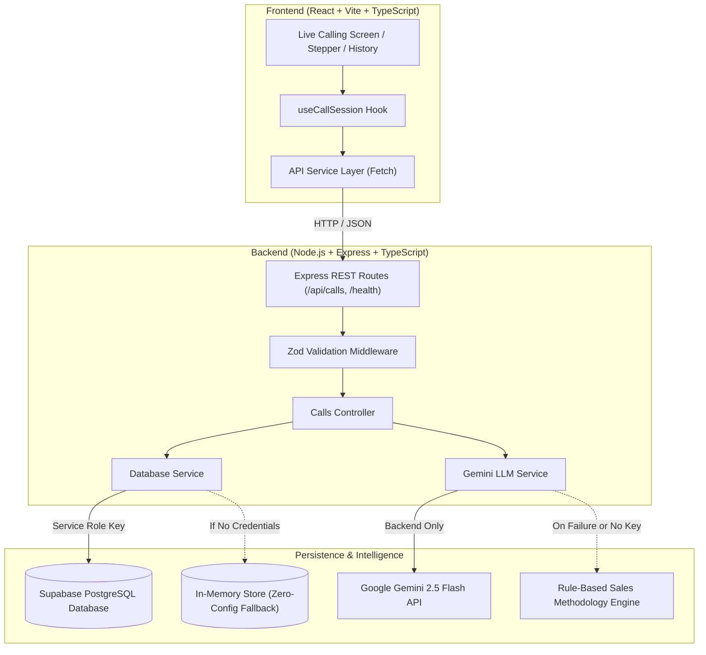

# ColdCall Copilot — Live Cold-Call Guidance & AI Sales Assistant

A production-ready, full-stack web application designed for sales representatives to keep open beside them during live B2B outbound cold calls. The application provides structured 8-stage methodology guidance, live objection handling battlecards, verbatim prospect quote logging, real-time AI stage recommendations powered by Google Gemini, completed call summaries, and persistent call history backed by Supabase PostgreSQL.

---

## 1. Project Overview

Cold calling in B2B sales is high-stress and fast-paced. Sales representatives frequently freeze during live objections, drift off-framework, or fail to capture verbatim prospect responses.

**ColdCall Copilot** solves this by delivering a calm, distraction-free, real-time cockpit that:
- Guides callers step-by-step through a battle-tested **8-Stage Outbound Framework**.
- Provides instant, contextual talking points and battlecards with one-click copy.
- Records verbatim prospect quotes and stage outcomes in persistent database storage.
- Generates live, contextual next-step recommendations and natural scripts using **Google Gemini LLM** (with zero-failure rule-based fallback).
- Synthesizes automated executive call summaries upon call completion.
- Maintains a searchable history of past calls for post-call reviews and coaching.

---

## 2. Key Features

- **Live Calling Guidance Screen**: Dual-column layout optimized for active phone conversations.
- **8 Modular Methodology Stages**:
  1. *Opener & Pattern Interrupt*
  2. *Reason for Call & Context Hook*
  3. *Problem Hypothesis & Discovery*
  4. *Value Proposition & Business Impact*
  5. *Qualification & Baseline Check*
  6. *Objection Handling & Clarification*
  7. *The Ask / Call-to-Action (Meeting Request)*
  8. *Wrap-up & Confirmation*
- **Outcome & Quote Recording**: Click-to-select stage outcomes with dedicated text area for verbatim prospect statements.
- **AI Copilot (Google Gemini)**: Analyzes prospect words and stage outcomes to recommend what to say next and whether to advance, compromise, or close.
- **Non-AI Resilience Fallback**: When LLM keys are absent, rate-limited, or network fails, the backend seamlessly activates the rule-based methodology engine—clearly labeled so reps are never misled.
- **Non-Linear Navigation**: Callers can jump between stages or revisit earlier stages without losing entered quotes or data.
- **Call Timer & Stage Stepper**: Real-time duration timer and interactive 8-step visual progress bar.
- **Executive Call Summary Generator**: One-click AI synthesis of call takeaways and next steps upon call completion or early exit.
- **Persistent Call History**: Filterable, searchable table and card view of past calls with a deep-inspection drawer showing full timeline and verbatim quotes.
- **Dual Database Architecture**: Direct Supabase PostgreSQL support with automatic in-memory fallback for immediate zero-config local evaluation.

---

## 3. Technology Stack

| Layer | Technologies |
|---|---|
| **Frontend** | React 18, Vite 5, TypeScript 5, Vanilla CSS Design System, Lucide Icons |
| **Backend** | Node.js (v20+), Express 4, TypeScript 5, Zod 3, TSX |
| **Database** | Supabase PostgreSQL (with automatic in-memory fallback store) |
| **LLM Provider** | Google Gemini (`gemini-2.5-flash` / `gemini-1.5-flash`) via `@google/generative-ai` |
| **Testing** | Vitest 2, Supertest 7 (19 passing unit and integration tests) |
| **Deployment** | Vercel (Frontend SPA) + Render (Express REST API Web Service) |

---

## 4. Architecture & Data Flow



### Security & Privacy Protections
1. **Backend-Only LLM Calls**: Browser bundles never touch LLM API keys.
2. **Prompt Injection Defense**: Prospect words are treated strictly as untrusted customer dialogue; system instructions explicitly block user-supplied prompt overrides.
3. **Payload Sanitization**: Request bodies are validated, length-capped, and HTML-escaped.
4. **Credential Isolation**: Database `service_role` keys are held exclusively on the server.

---

## 5. Folder Structure

```
.
├── database/
│   ├── schema.sql           # Supabase PostgreSQL schema with tables, indexes, triggers & RLS
│   └── README.md            # Database provisioning and migration guide
├── server/
│   ├── src/
│   │   ├── config/env.ts    # Typed environment configuration loader
│   │   ├── controllers/     # Express route controllers
│   │   ├── middleware/      # Error handler and CORS configuration
│   │   ├── routes/          # REST route definitions
│   │   ├── schemas/         # Zod validation schemas
│   │   ├── services/        # Supabase/Memory DB service & Gemini LLM service
│   │   ├── app.ts           # Express application setup
│   │   └── index.ts         # Server HTTP listener entrypoint
│   └── tsconfig.json        # Backend TypeScript compiler configuration
├── shared/
│   ├── stages.ts            # Structured 8-stage cold-call methodology data
│   └── types.ts             # Shared TypeScript types for API and models
├── src/
│   ├── components/          # Reusable UI components (Navbar, Header, Guidance, Logger, AI Card)
│   ├── hooks/               # useCallSession state management hook
│   ├── pages/               # ActiveCallPage & CallHistoryPage
│   ├── services/            # Frontend API client
│   ├── utils/               # Time/Date formatters and status helpers
│   ├── App.tsx              # Root app component with modal and toast orchestration
│   ├── index.css            # Custom executive dark design system
│   └── main.tsx             # React DOM root entrypoint
├── tests/
│   └── api.test.ts          # Comprehensive Vitest/Supertest API test suite
├── .env.example             # Safe template for environment variables
├── .gitignore               # Ignored artifacts, node_modules, and env secrets
├── package.json             # Root monorepo scripts and dependencies
├── render.yaml              # Render deployment blueprint
├── vercel.json              # Vercel SPA rewrite configuration
└── vite.config.ts           # Vite bundler configuration with proxies and path aliases
```

---

## 6. Prerequisites

- **Node.js**: v20.0.0 or later (tested on v26.7.0)
- **npm**: v10.0.0 or later
- **Git**

---

## 7. Local Installation & Quickstart

```bash
# 1. Clone repository
git clone https://github.com/<your-username>/cold-call-assistant.git
cd cold-call-assistant

# 2. Install all dependencies
npm install

# 3. Create your local environment file
cp .env.example .env
```

---

## 8. Environment Variable Setup

Edit `.env` (or set environment variables in your deployment dashboards):

```env
# Frontend Configuration
VITE_API_BASE_URL=http://localhost:5000

# Backend Configuration
PORT=5000
NODE_ENV=development
FRONTEND_ORIGIN=http://localhost:5173

# Supabase PostgreSQL (Optional for local test; automatic memory fallback enabled)
SUPABASE_URL=https://your-project-id.supabase.co
SUPABASE_SERVICE_ROLE_KEY=your-supabase-service-role-key-here

# LLM Provider Configuration
LLM_PROVIDER=gemini
LLM_API_KEY=your-google-gemini-api-key-here
LLM_MODEL=gemini-2.5-flash
```

---

## 9. Supabase Database Setup

1. Create a free project at [supabase.com](https://supabase.com).
2. Navigate to the **SQL Editor** tab.
3. Paste the contents of [`database/schema.sql`](file:///database/schema.sql) and execute the query.
4. Copy your **Project URL** and **`service_role`** secret key from **Project Settings -> API**.
5. Set `SUPABASE_URL` and `SUPABASE_SERVICE_ROLE_KEY` in your backend environment.

*(Detailed step-by-step instructions are available in [`database/README.md`](file:///database/README.md).)*

---

## 10. LLM Provider Setup (Google Gemini)

1. Obtain a free API key from [Google AI Studio](https://aistudio.google.com/).
2. In your backend `.env`, configure:
   ```env
   LLM_PROVIDER=gemini
   LLM_API_KEY=AIzaSy...
   LLM_MODEL=gemini-2.5-flash
   ```
3. If no key is set or the provider encounters network errors, ColdCall Copilot automatically uses its verified sales methodology engine with a clear non-AI badge.

---

## 11. Running the Application Locally

```bash
# Run both Frontend (port 5173) and Backend (port 5000) concurrently:
npm run dev

# Or run separately in two terminal tabs:
npm run server:dev   # Backend on http://localhost:5000
npm run client:dev   # Frontend on http://localhost:5173
```

Open [http://localhost:5173](http://localhost:5173) in your browser.

---

## 12. Running Tests & Production Builds

```bash
# Run automated API & unit test suite (19 test cases)
npm test

# Run TypeScript typecheck across frontend and backend
npm run lint

# Build production bundles
npm run build
```

---

## 13. REST API Documentation

### Health Check
- **`GET /health`**
  - Response `200 OK`:
    ```json
    {
      "status": "ok",
      "service": "cold-call-assistant-api",
      "version": "1.0.0",
      "timestamp": "2026-10-18T17:35:00.000Z",
      "database": "supabase",
      "llmProvider": "gemini",
      "llmConfigured": true,
      "uptimeSeconds": 142
    }
    ```

### Calls Endpoints
- **`POST /api/calls`**
  - Body: `{ "prospect_name": "Sarah Connor", "prospect_company": "Cyberdyne" }`
  - Response `201 Created`: Returns created call record with UUID.

- **`GET /api/calls`**
  - Response `200 OK`: Returns list of saved calls ordered by date descending.

- **`GET /api/calls/:id`**
  - Response `200 OK`: Returns call metadata and array of recorded stage results.

- **`PATCH /api/calls/:id`**
  - Body: `{ "status": "completed", "current_stage_number": 8, "summary": "Meeting scheduled." }`
  - Response `200 OK`: Returns updated call record.

- **`PUT /api/calls/:id/stages/:stageNumber`**
  - Body:
    ```json
    {
      "outcome": "permission_granted",
      "prospect_words": "I have about 30 seconds before my standup.",
      "caller_notes": "Sounded hurried"
    }
    ```
  - Response `200 OK`: Upserts stage result without duplicate entries.

- **`POST /api/calls/:id/ai-suggestion`**
  - Body:
    ```json
    {
      "stage_number": 1,
      "outcome": "permission_granted",
      "prospect_words": "I have about 30 seconds."
    }
    ```
  - Response `200 OK`:
    ```json
    {
      "recommendedNextStage": 2,
      "nextStepLabel": "Advance to Stage 2: Reason for Call & Context Hook",
      "suggestedScript": "I noticed on LinkedIn that Cyberdyne is scaling its SDR pod...",
      "rationale": "Permission granted; deliver your 15-second value hook immediately.",
      "detectedObjection": null,
      "confidence": "high",
      "is_fallback": false,
      "provider": "Google Gemini (gemini-2.5-flash)"
    }
    ```

- **`POST /api/calls/:id/summary`**
  - Response `200 OK`:
    ```json
    {
      "summary": "Cold call completed with Sarah Connor. Addressed SDR ramp time friction; agreed to 15-min discovery demo.",
      "keyTakeaways": ["Stage 1: Permission granted", "Stage 2: Hook resonated", "Meeting invite sent"],
      "nextSteps": "Send calendar hold with discovery agenda.",
      "is_fallback": false,
      "provider": "Google Gemini (gemini-2.5-flash)"
    }
    ```

---

## 14. Deployment Instructions

### A. Deploy Backend to Render
1. Push your code to GitHub.
2. Sign in to [Render](https://render.com/) and click **New + -> Web Service**.
3. Connect your GitHub repository.
4. Settings:
   - **Environment**: `Node`
   - **Build Command**: `npm install && npm run build`
   - **Start Command**: `npm run server:start`
   - **Health Check Path**: `/health`
5. Add Environment Variables:
   - `NODE_ENV`: `production`
   - `PORT`: `10000`
   - `FRONTEND_ORIGIN`: `https://your-vercel-app.vercel.app`
   - `SUPABASE_URL`: `https://your-project.supabase.co`
   - `SUPABASE_SERVICE_ROLE_KEY`: `eyJ...`
   - `LLM_PROVIDER`: `gemini`
   - `LLM_API_KEY`: `AIza...`
   - `LLM_MODEL`: `gemini-2.5-flash`
6. Click **Deploy Web Service** and note your Render URL (e.g., `https://cold-call-assistant-api.onrender.com`).

### B. Deploy Frontend to Vercel
1. Sign in to [Vercel](https://vercel.com/) and click **Add New -> Project**.
2. Import your GitHub repository.
3. Settings:
   - **Framework Preset**: `Vite`
   - **Build Command**: `npm run client:build`
   - **Output Directory**: `dist`
4. Environment Variables:
   - `VITE_API_BASE_URL`: `https://cold-call-assistant-api.onrender.com` (your deployed Render URL)
5. Click **Deploy**.
6. Once deployed, copy your Vercel URL and add it to Render's `FRONTEND_ORIGIN` environment variable.

---

## 15. Verified Deployment URLs

- **Live Vercel Application**: `[Pending Deployment - Add URL once deployed]`
- **Render Backend Health Endpoint**: `[Pending Deployment - Add URL once deployed/health]`
- **Selected LLM Provider**: Google Gemini (`gemini-2.5-flash`)

*(Follow the exact steps in Section 14 to deploy using your personal Vercel and Render accounts.)*

---

## 16. Six-Minute Demonstration Video Guide

Use this timestamped speaking plan for your recorded walkthrough:

| Timestamp | Segment | Key Talking Points |
|---|---|---|
| **0:00–0:40** | **Introduction** | Introduce the problem: sales reps lose deals in the first 60 seconds from unexpected resistance. Introduce ColdCall Copilot built with React, TypeScript, Express, Supabase, and Google Gemini. |
| **0:40–1:40** | **Start a Call** | Open the live application. Click "Start New Call", enter "Sarah Connor, Cyberdyne Systems". Point out the live duration timer, Stage 1 battlecard, and the interactive 8-stage stepper. |
| **1:40–2:40** | **Record a Stage** | Demonstrate the outcome picker ("Permission Granted"). Type the prospect's verbatim quote ("I've got 30 seconds before my standup"). Click "Save Stage Result" and explain Supabase persistence. |
| **2:40–3:40** | **Demonstrate LLM** | Click "Get AI Stage Recommendation". Point out the structured JSON response: suggested natural script to say, the rationale, and the confidence rating. Explain backend-only LLM execution and prompt injection protection. |
| **3:40–4:40** | **Advance & Complete** | Proceed to Stage 2. Revisit Stage 1 to show saved state is retained. Advance and complete call. Click "Generate with AI" in the summary modal to synthesize key takeaways. |
| **4:40–5:30** | **Inspect History** | Navigate to Call History. Show Sarah Connor's completed call. Click "Inspect" to reveal the full stage-by-stage quote transcript and timestamps. |
| **5:30–6:00** | **Closing** | Recap clean human-readable codebase, 19 automated tests, and Supabase integration. Mention future roadmap: CRM webhook sync and browser speech-to-text. |

---

## 17. Final Submission Checklist

- [x] **1. Public GitHub Repository**: Clean codebase, schema, tests, and documentation.
- [ ] **2. Live Vercel Application URL**: Ready to deploy via Section 14B.
- [ ] **3. Render Backend Health URL**: Ready to deploy via Section 14A.
- [ ] **4. Six-Minute Demonstration Video URL**: Ready to record using Section 16 speaking notes.

---

## 18. Known Limitations & Future Enhancements

- **Speech-to-Text Integration**: The current MVP uses manual keyboard entry by the caller to respect strict privacy and avoid intrusive recording. A future version could offer opt-in WebRTC real-time transcription.
- **CRM Bi-Directional Sync**: Adding direct integrations with HubSpot and Salesforce to push completed call summaries and outcomes directly to CRM contacts.
- **Multi-Tenant Authentication**: While the schema supports multi-user tenancy, current MVP access is single-pod oriented via service-role keys. Adding Supabase Auth / Clerk is the natural next step.
